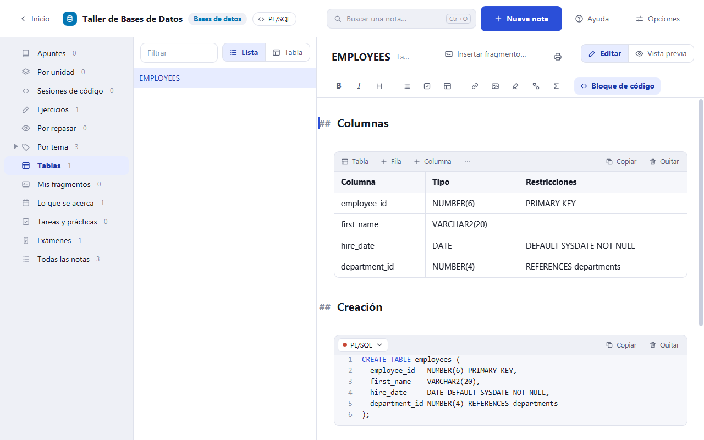
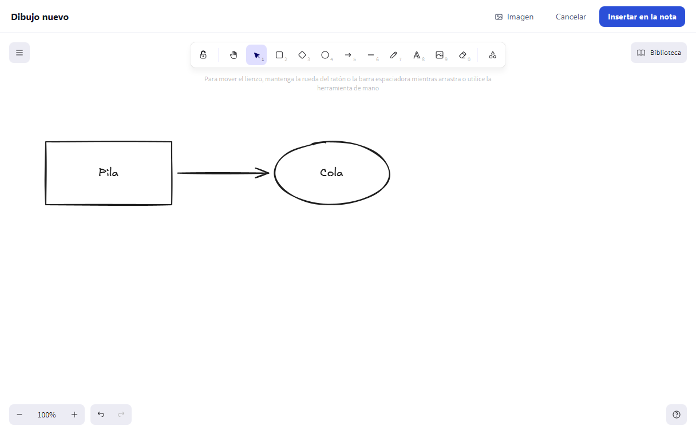
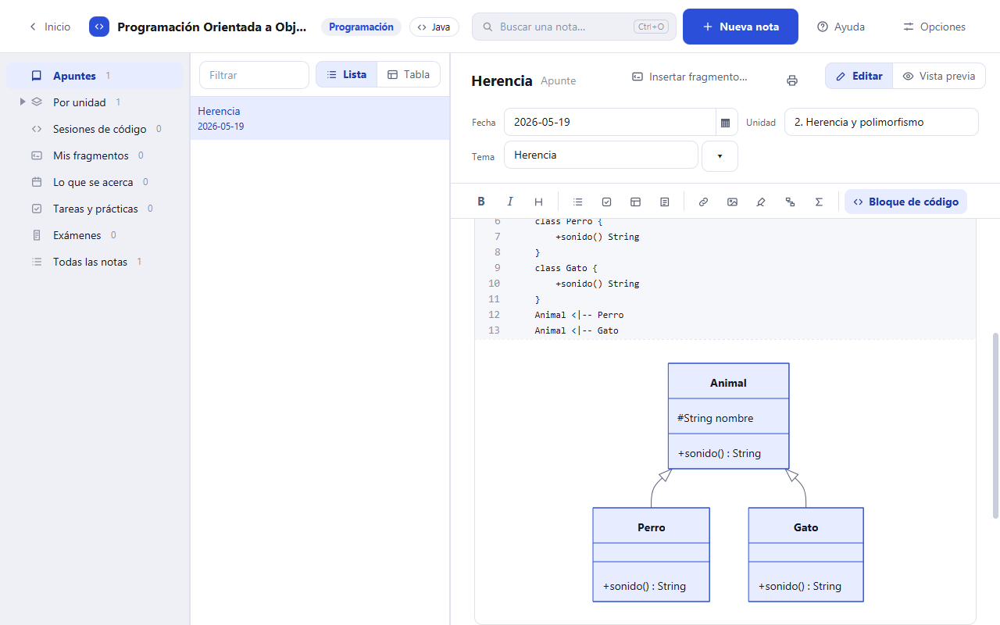
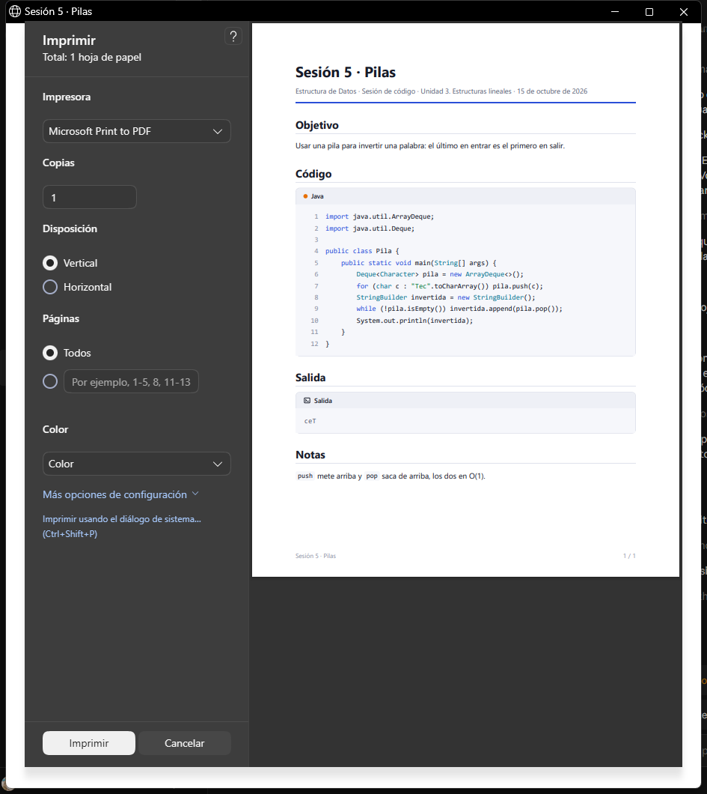
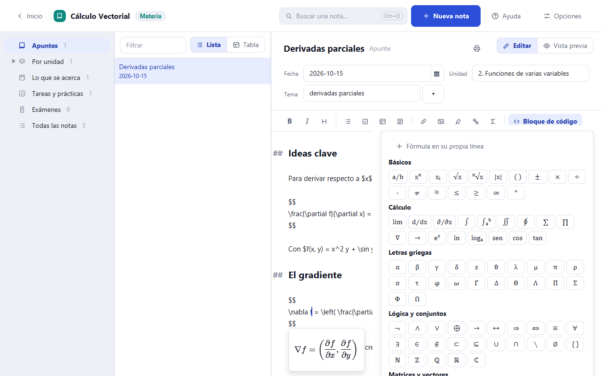
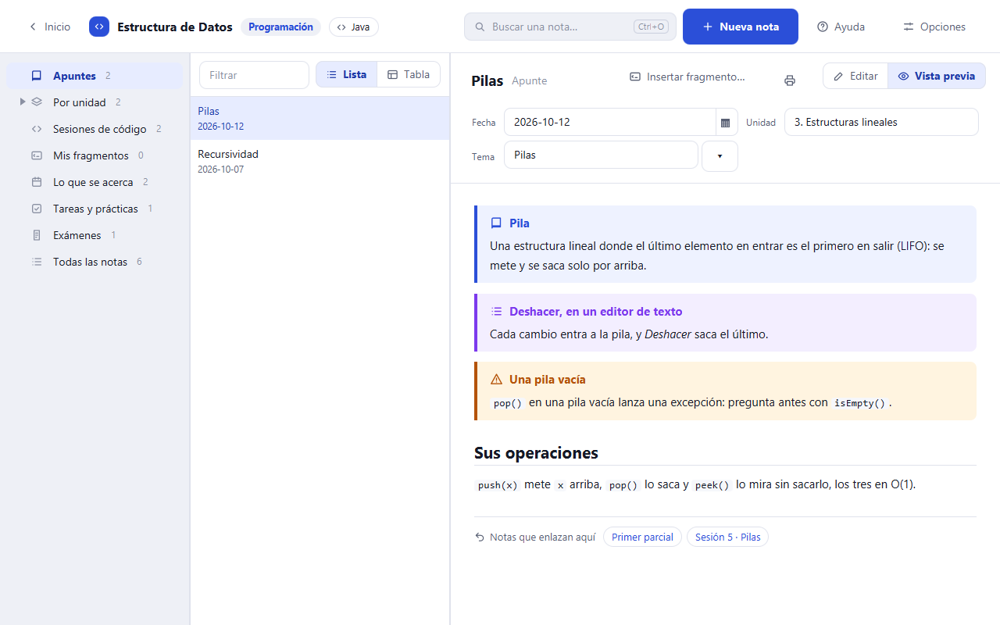

# Devava Notes

[](https://github.com/HideOnVava/devava-notes/releases/latest)
[](https://github.com/HideOnVava/devava-notes/actions/workflows/ci.yml)
[](#descarga)
[](LICENSE)

La app de apuntes de los estudiantes de **Ingeniería en Sistemas Computacionales** del
**Instituto Tecnológico de La Laguna**, hecha por **devava XP Studios**.

Cada materia del semestre tiene su cuaderno, que sabe lo que lleva: tus **apuntes** por unidad,
las **tareas y prácticas** con su fecha de entrega, los **exámenes**, y en las materias de
programación, **sesiones de código** con el código y lo que imprimió. Las materias salen de la
retícula de ISC: escribes «estruc» y la app propone *Estructura de Datos*, de Programación y en
Java. Tus notas llevan **fórmulas** con sus símbolos a un clic, **tablas** que se escriben como
en Excel, **dibujos** hechos sin salir de la app y **diagramas** que se dibujan solos a partir de
su texto, y salen en **PDF** o en papel tal como se ven. Toda la app está en español, y tus
notas son archivos de texto en tu computadora: sin cuentas, sin nube y sin instalar Java.

| Inicio | Una sesión de código |
| --- | --- |
|  |  |

| Nueva materia, desde la retícula | La primera vez |
| --- | --- |
|  |  |

| Una materia, en vista previa | Bases de datos, en tema oscuro |
| --- | --- |
|  |  |

| Una tabla, escrita en sus celdas | Un dibujo |
| --- | --- |
|  |  |

| Un diagrama, que se dibuja mientras lo escribes | Imprimir, o guardar como PDF |
| --- | --- |
|  |  |

| Una fórmula, con sus símbolos a un clic | Recuadros, y las notas que enlazan aquí |
| --- | --- |
|  |  |

## Descarga

**[⬇ Descarga la última versión](https://github.com/HideOnVava/devava-notes/releases/latest)**
para Windows 10 u 11 de 64 bits. En esa página, en **Assets**:

| Archivo | Luego |
| --- | --- |
| `…-windows-x64-setup.exe` | **Recomendado.** Ábrelo. Si Windows muestra *«Windows protegió su PC»*, haz clic en **Más información → Ejecutar de todas formas** ([por qué](#por-qué-windows-muestra-una-advertencia)). Deja la carpeta que propone y termina: Devava Notes queda en el menú Inicio y, si no quitas la casilla, en el escritorio. No necesita permisos de administrador. |
| `…-windows-x64-portable.zip` | Sin instalar: descomprímelo donde quieras (sirve una USB) y abre `Devava Notes.exe`. |

Las versiones para macOS y Linux vienen después.

### Primeros pasos

1. **Elige tus materias.** La primera vez, la app te muestra la retícula de ISC por semestre:
   marca las que llevas y cada una tendrá su cuaderno, con su tipo y su lenguaje. Después
   agrega más con **Nueva materia**.
2. **Escribe.** **Nueva nota** (`Ctrl+N`) ofrece lo que lleva cada materia: un apunte, una
   sesión de código, una tarea o un examen. La barra sobre la nota pone negritas, listas,
   tablas, recuadros, fórmulas, imágenes, dibujos, diagramas y bloques de código con un clic.
3. **Llena sus datos** arriba del texto (la entrega de una tarea, los temas de un examen):
   Inicio te dice lo que se acerca, y lo atrasado sale en rojo.

La nota **Primeros pasos → Cómo usar Devava Notes** tiene un ejemplo de todo; bórrala cuando ya
no la necesites.

### Actualizar y desinstalar

Cuando hay una versión nueva, la barra de la app lo dice (**Nueva versión**, con su número), y
un clic abre su página. Para saberlo, al abrir pregunta a GitHub cuál es la última versión: solo
envía el número de la tuya, nada de tus notas.

Una versión nueva se instala igual: el instalador reemplaza la anterior. Para desinstalarla:
*Configuración → Aplicaciones → Aplicaciones instaladas → Devava Notes → Desinstalar* (la
portable: borra su carpeta). En los dos casos tus notas se quedan en tu carpeta Documentos.

### ¿Por qué Windows muestra una advertencia?

Las descargas no están firmadas: un certificado de firma se paga cada año, y este es un
proyecto gratuito. Por eso Windows muestra *«Windows protegió su PC»* la primera vez; **Más
información → Ejecutar de todas formas** la abre, y Windows lo recuerda. GitHub Actions
compila cada versión desde el código de su etiqueta, así que el registro de la compilación
muestra exactamente qué lleva cada archivo, y cada versión publica sus sumas SHA-256.

## Tipos de cuaderno

Cada tipo trae sus datos (arriba de la nota), sus plantillas para las notas nuevas y sus vistas
(a la izquierda). Cada vista muestra sus notas como lista o como tabla, con columnas para
ordenar.

- **Materia** (Cálculo, Física, Química, Contabilidad…): *apuntes* (fecha, unidad, tema),
  *tareas y prácticas* (entrega, estado) y *exámenes* (fecha, temas, calificación). Vistas:
  apuntes, por unidad, **lo que se acerca** (lo pendiente, lo más próximo primero y lo
  atrasado en rojo), tareas y prácticas, exámenes y todas las notas. Clic derecho en una tarea
  para marcarla como hecha.
- **Programación** (Fundamentos de Programación, POO, Estructura de Datos, Tópicos, Web…): lo de
  una Materia, más **sesiones de código** (lo que se programó en clase y lo que imprimió) y
  **mis fragmentos**, el código para reutilizar. Cada materia tiene su lenguaje (Java, C++, C#,
  Python…), que se ve junto a su nombre: los bloques de código nuevos empiezan en él.
- **Bases de datos** (Fundamentos, Taller y Administración de Bases de Datos): lo de
  Programación, con SQL o con el PL/SQL de Oracle, más *ejercicios* (temas, nivel, estado),
  las *tablas* del esquema y la vista **por tema** (`plsql/cursores` queda dentro de `plsql`;
  los temas propuestos van de `consultas/joins` a `plsql/disparadores`).
- **Programación competitiva**: problemas de Codeforces, AtCoder y LeetCode. Pega el enlace del
  problema y se llenan su juez, su ID y un bloque de solución con tu plantilla de C++. Vistas
  por algoritmo (`graphs/dijkstra` dentro de `graphs`), técnica, dificultad (una escala para
  los tres jueces, en sus colores), juez y estado; **por repasar** junta lo que resolviste con
  ayuda, y la **biblioteca de código** guarda lo que reutilizas.
- **Libre**: lo que no es una materia (ideas, la residencia, proyectos), con etiquetas y notas
  fijadas.

En Inicio, las materias se agrupan por periodo escolar (*Ene–Jun*, *Verano*, *Ago–Dic*) y los
semestres anteriores quedan plegados; *Cambiar periodo…* mueve una materia a otro. Libre y
Programación competitiva son **cuadernos libres**: no tienen semestre, van en su propia sección
y se crean con **Nuevo cuaderno libre**. **Lo que se acerca** junta las entregas y los exámenes
de todas tus materias.

## Escribir

Las notas son Markdown, pero no hace falta saberlo: la barra sobre la nota lo escribe por ti, y
**Vista previa** (`Ctrl+E`) muestra la nota terminada. `Ctrl++` y `Ctrl+-` agrandan o achican
su texto, y la app recuerda el tamaño.

- **Bloques de código** como tarjetas: arriba de cada uno eliges su lenguaje (Java, C++, C,
  Python, C#, JavaScript, SQL, PL/SQL o cualquier otro), lo copias o lo quitas; el código sale
  con colores y con números de línea. Un bloque de **Salida** guarda lo que imprimió el
  programa, y **+ Bloque de código** agrega otro en el lenguaje de la materia. Quien sabe
  Markdown puede escribir ```` ```java ```` y Enter.
- **Tablas** como cuadrícula: se escribe en sus celdas, **Tab** pasa a la siguiente y **Enter**
  a la de abajo (al final agrega una fila). Créala con **Tabla** en la barra (eliges columnas y
  filas), pegando celdas de Excel, Google Sheets o SQL Developer, o escribiendo su encabezado
  (`| Nombre | Edad |`) y Enter. Arriba de cada una: **+ Fila**, **+ Columna**, **⋯** para
  quitar o alinear, **Copiar** (se pega con sus celdas en Word, Excel o Google Docs) y
  **Quitar**.
- **Dibujos** con Excalidraw, sin salir de la app: **Dibujo** en la barra abre una ventana para
  dibujar diagramas y esquemas, con imágenes y capturas para dibujar encima, Mermaid y una
  biblioteca de figuras. Un clic en el dibujo lo vuelve a abrir.
- **Diagramas** escritos como texto, con [Mermaid](https://mermaid.js.org): **Diagrama** en la
  barra agrega uno de flujo, de clases, entidad-relación, de secuencia o de estados para
  cambiarlo, y quien sabe Mermaid escribe ```` ```mermaid ````. Se dibuja debajo de su texto
  mientras lo escribes y, si algo está mal, dice en qué línea; la vista previa lo muestra
  dibujado.
- **Fórmulas**, dibujadas por KaTeX: `$e^{i\pi} + 1 = 0$` en el texto, o en su propia línea
  entre `$$`. No hace falta saber LaTeX: **Fórmula**, en la barra, tiene sus símbolos a un clic
  (básicos, de cálculo, letras griegas, de lógica y conjuntos, y de matrices y vectores), y la
  fórmula que escribes se ve dibujada debajo; si algo está mal, dice qué.
- **Recuadros** de colores para una definición, un ejemplo, algo importante o una advertencia:
  **Recuadro** en la barra, o como en Obsidian, `> [!definition] Pila` (también con sus
  palabras en español, como `[!ejemplo]`).
- **Enlaces** entre notas: escribe `[[` y elige su título, también en las celdas de una tabla.
  `Ctrl+clic` sigue un enlace al escribir, un clic en la vista previa; un enlace a una nota que
  aún no existe la crea. Al cambiar el nombre de una nota, sus enlaces cambian con ella, y al
  final de cada nota están las que la enlazan, de cualquier materia.
- **Etiquetas**: `#tema` en cualquier parte del texto (también `#tema/subtema`); un clic en una
  muestra las notas que la tienen.
- **Imágenes**: pega una con `Ctrl+V` (una captura de pantalla, por ejemplo) o arrastra el
  archivo a la nota; se guarda en la carpeta `attachments` de la materia. Se ve mientras
  escribes: arrastra su esquina, o elige **Chica**, **Mediana** o **Grande** sobre ella, y la
  vista previa y el PDF la muestran de ese tamaño (se guarda como en Obsidian, ``).
- **Temas sugeridos**: en las materias de la retícula, el menú ▾ de *Temas* propone los de la
  materia (herencia y polimorfismo en POO, pilas y colas en Estructura de Datos…).
- Listas de pendientes (`- [ ]`) y tachado, como en GitHub.

## PDF e impresión

El botón de la impresora, junto a *Vista previa*, **exporta la nota a PDF**, que se abre al
terminar, o la **imprime** (`Ctrl+P`), tal como la muestra la vista previa: fórmulas, código
con colores, tablas, imágenes, dibujos y diagramas. Sale en hoja carta, con el título y lo que
es la nota arriba (su materia, su tipo, su unidad y su fecha) y el número de página abajo; el
clic derecho en una nota de la lista hace lo mismo sin abrirla. Lo hace Microsoft Edge, que
viene con Windows, sin abrir otra ventana ni usar tu cuenta: tus notas no salen de tu
computadora.

## Atajos de teclado

| Tecla | Qué hace |
| --- | --- |
| `Ctrl+N` | Nueva materia (en Inicio) o nueva nota (en una materia) |
| `Ctrl+O` | Abrir cualquier nota por su título |
| `Ctrl+Shift+F` | Buscar en el texto de todas las notas (sin importar acentos ni mayúsculas) |
| `Ctrl+E` | Pasar entre Editar y Vista previa |
| `Ctrl+P` | Imprimir la nota (el botón de la impresora también la exporta a PDF) |
| `Ctrl++`, `Ctrl+-` | Agrandar o achicar el texto de la nota (también `Ctrl` y la rueda del ratón); `Ctrl+0` lo deja como era |
| `Ctrl+F` | Buscar y reemplazar en la nota |
| `Ctrl+B`, `Ctrl+I` | Negrita, cursiva |
| `Ctrl+V` | Pegar texto, una imagen, o celdas de Excel como tabla |
| `Tab`, `Enter` | En una tabla: la celda siguiente, la de abajo |
| `[[` | Enlazar otra nota, con sus títulos sugeridos |
| `Ctrl+clic` | Seguir el `[[enlace]]` bajo el ratón, al escribir |
| `Ctrl+Z` / `Ctrl+Y` | Deshacer / rehacer |

## Dónde quedan tus notas

Todo queda en una carpeta `Devava Notes` dentro de tu carpeta Documentos (también si OneDrive
la sincroniza). Cada materia o cuaderno es una carpeta, y cada nota un archivo `.md` con su
título:

```
Documentos\Devava Notes\
├── settings.json                        el tema y el tamaño del texto
├── Biblioteca de dibujos.excalidrawlib  las figuras que guardas para tus dibujos
└── Estructura de Datos\
    ├── .notebook.json                   su tipo, su lenguaje, su periodo y su materia en la retícula
    ├── attachments\                     las imágenes y los dibujos de sus notas
    └── Sesión 5 · Pilas.md
```

Un dibujo es un PNG (`Dibujo ….excalidraw.png`) que lleva adentro lo dibujado: cualquier visor
de imágenes lo abre, y la app lo vuelve a abrir para seguir dibujando.

Los datos de una nota son su encabezado YAML, así que los archivos se abren en cualquier editor
de Markdown (Obsidian incluido), y las notas escritas en otro lado aparecen en la app. Sus
valores se guardan en inglés (`status: Solved`), como en las versiones anteriores, aunque la
app los muestre en español:

~~~markdown
---
kind: session
date: 2026-10-12
unit: 3. Estructuras lineales
topics: [pilas]
---
## Código

```java
Deque<Character> pila = new ArrayDeque<>();
```
~~~

- Cada cambio se guarda solo, un momento después, y cada archivo se escribe completo o no se
  escribe: un apagón nunca deja media nota.
- Borrar una nota o una materia la manda a la Papelera de reciclaje.
- Las carpetas que crees a mano son cuadernos libres.
- **Para compartir una materia** (tus apuntes con tus compañeros, por ejemplo): en su menú,
  *Exportar como ZIP…*. Quien recibe el ZIP la agrega con *Opciones → Importar un cuaderno
  (ZIP)…* en Inicio, y se abre tal como estaba, con su tipo, sus imágenes y sus dibujos.
- Para guardar las notas en otro lugar, abre la app con `-Dnotes.home=<carpeta>` (desde el
  código) o define la variable de entorno `JAVA_TOOL_OPTIONS=-Dnotes.home=<carpeta>` (la app
  instalada). La app se abre una vez por carpeta de notas: abrirla de nuevo trae su ventana al
  frente.
- **Si algo falla**, *Ayuda → Reportar un problema…* abre GitHub con la versión y las últimas
  líneas del registro de errores, que la app guarda en
  `%LOCALAPPDATA%\devava XP Studios\Devava Notes`.

---

## Para desarrolladores

Java 21, JavaFX 21 (con WebView), Maven (con su wrapper), Gson y commonmark-java. El editor es
CodeMirror 6, con KaTeX para las fórmulas, empaquetado por esbuild en un solo script que carga
el WebView; Mermaid, para los diagramas, va aparte en `diagrams.js`, que se carga cuando una
nota tiene uno, y la ventana de dibujo es Excalidraw (con React), en `draw.js`. Los PDF y la
impresión los hace Microsoft Edge a partir de la vista previa
([`Pdf.java`](src/main/java/com/devavaxp/notes/Pdf.java)). Las pruebas usan JUnit 5; el
compilador corre con `-Xlint:all` y la compilación debe quedar sin advertencias. El código y
sus comentarios están en inglés; lo que ve el estudiante, en español.

```bash
./mvnw javafx:run                  # correr desde el código (requiere el JDK 21)
./mvnw test                        # las pruebas unitarias
./mvnw verify -Dsmoke=true         # también abre la ventana real y guarda capturas en target/smoke
```

El código del editor está en [`editor/main.js`](editor/main.js), y el de la ventana de dibujo en
[`editor/draw.js`](editor/draw.js). Después de cambiarlos, vuelve a empaquetarlos (con Node.js
20 o más nuevo) y sube el resultado, `editor.js`, `diagrams.js`, `draw.js`, `draw.css` y las
fuentes de `src/main/resources/com/devavaxp/notes/`:

```bash
cd editor
npm install
npm run build
```

La retícula está en
[`reticula-isc.json`](src/main/resources/com/devavaxp/notes/reticula-isc.json): las 55
materias de ISC de Devava Kardex, con el tipo, el lenguaje y los temas que la app propone para
cada una.

El ícono lo dibuja [`tools/icon/Icon.java`](tools/icon/Icon.java): `java tools/icon/Icon.java`
escribe `packaging/icon.png`, `packaging/icon.ico` y el ícono de la ventana.

### Compilar la aplicación

`packaging/build-windows.ps1` compila con el wrapper de Maven, copia las dependencias, arma un
runtime de Java recortado con `jlink` (los módulos de `packaging/jdk-modules.txt` más JavaFX) y
llama a `jpackage` con ese runtime y los jars en el class path. Necesita un JDK 21 completo (con
su carpeta `jmods`), que encuentra por `JAVA_HOME` o `-JdkHome`:

```powershell
powershell -ExecutionPolicy Bypass -File .\packaging\build-windows.ps1
```

El resultado es `dist\Devava Notes\Devava Notes.exe`. `-Destination "$env:LOCALAPPDATA\Programs" -Shortcut`
la instala para ti con un acceso directo en el escritorio, y `-Type exe` arma el instalador, en
español, que necesita el [WiX Toolset 3.x](https://github.com/wixtoolset/wix3/releases).

### Publicar una versión

GitHub Actions compila, prueba y publica cada versión
([`.github/workflows/release.yml`](.github/workflows/release.yml)), así que cada descarga sale
de una compilación limpia de un commit etiquetado. Para publicar, por ejemplo, la versión 2.5.0:

1. Pon `<version>2.5.0</version>` en `pom.xml`.
2. Agrega una sección `## [2.5.0] - <fecha>` a [`CHANGELOG.md`](CHANGELOG.md) (es el «Qué hay
   de nuevo» de la versión) y su enlace al final del archivo.
3. Sube los cambios, y luego la etiqueta:

   ```bash
   git tag v2.5.0
   git push origin v2.5.0
   ```

Correr el workflow a mano desde la pestaña *Actions* es un ensayo: compila y prueba todo y
guarda los archivos como artefactos, sin publicar nada.

## Licencia

[MIT](LICENSE) © 2026 devava XP Studios. La app incluye CodeMirror, KaTeX, Excalidraw, React y
Mermaid (MIT) con sus librerías, las fuentes de Excalidraw (SIL OFL 1.1), commonmark-java
(BSD-2-Clause), Gson (Apache-2.0) y un runtime de Java con JavaFX (GPL-2.0 con la Classpath
Exception); ver [THIRD-PARTY-NOTICES.md](THIRD-PARTY-NOTICES.md).
