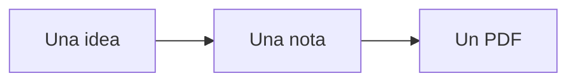

Esta nota es un ejemplo de lo que puede llevar una nota de Devava Notes. Bórrala cuando ya no la necesites.

## Tus materias

Cada materia tiene sus **apuntes**, **tareas**, **exámenes** y, en las de programación, **sesiones de código**. Agrega otra con **Nueva materia** en Inicio: búscala en la retícula de ISC y la app propone su tipo y su lenguaje.

Lo que no es de una materia, como ideas, proyectos o la residencia, va en **Cuadernos libres**, que no tienen semestre: crea uno con **Nuevo cuaderno libre**. Esta nota está en uno.

## Escribir

La barra sobre la nota pone **negritas**, *cursivas*, títulos, listas y casillas con un clic:

- [x] Leer esta nota
- [ ] Crear mi primera sesión de código

Una fórmula, como en LaTeX: $\int_0^1 x^2\,dx = \frac{1}{3}$. No hace falta saberlo: **Fórmula**, en la barra, tiene sus símbolos a un clic, y mientras la escribes se ve dibujada debajo.

Las imágenes se ven mientras escribes: arrastra su esquina, o elige **Chica**, **Mediana** o **Grande** sobre ella, para cambiar su tamaño.

Una tabla, con **Tabla** en la barra o pegando celdas de Excel. Se escribe en sus celdas; Tab pasa a la siguiente y Enter a la de abajo:

| Estructura | Inserta | Busca |
| --- | :---: | :---: |
| Arreglo | O(n) | O(1) |
| Pila | O(1) | O(n) |

**Recuadro** pone una definición, un ejemplo, algo importante o una advertencia en un recuadro de su color:

> [!definition] Pila
> Una estructura donde el último en entrar es el primero en salir.

Para enlazar otra nota, escribe dos corchetes y elige su título (también dentro de una tabla); al final de cada nota están las que la enlazan. Para etiquetar una nota, escribe una palabra con #, como #ejemplo.

## Código

**Bloque de código** agrega uno en el lenguaje de la materia. Arriba de cada bloque eliges su lenguaje, lo copias o lo quitas:

```java
public class Hola {
    public static void main(String[] args) {
        System.out.println("¡Hola, Tec!");
    }
}
```

Lo que imprimió el programa va en un bloque de **Salida**:

```output
¡Hola, Tec!
```

## Diagramas

**Diagrama**, en la barra, agrega uno de flujo, de clases, entidad-relación, de secuencia o de estados. Se escribe como texto (Mermaid) y se dibuja solo debajo:



## Vista previa

**Vista previa** (Ctrl+E) muestra la nota como queda: las fórmulas, el código con colores y las imágenes. Ctrl+ y Ctrl− agrandan o achican el texto. Así sale también en papel: el botón de la impresora, junto a Vista previa, la exporta a PDF o la imprime (Ctrl+P). Tus notas se guardan solas, como archivos de texto que también abren otros programas; **Opciones → Abrir la carpeta de datos** te lleva a ellas.
